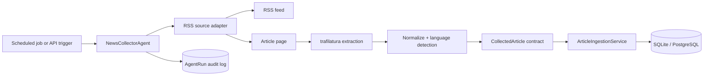

# Phase 1 architecture: News Collector Agent

## Responsibility boundaries

`RSSCollector` knows HTTP, RSS, and extraction only. `ArticleIngestionService` knows idempotent persistence only. `NewsCollectorAgent` orchestrates those pieces and creates the audit record. This separation lets a future website scraper, a paid/free API adapter, or a queue worker plug in without a database rewrite.

`Article` is the durable hand-off contract. The future Deduplication Agent will add semantic-cluster records and relationships; it must not delete source evidence. The Credibility Agent will write its evidence and score in separate tables, preserving independent concerns.

## Operating safely

- Use feeds whose terms permit your intended use and set a real contact address in `NEWS_USER_AGENT`.
- Keep the default 15-minute interval until sources' rate limits are known.
- Review source trust tiers in configuration before using articles downstream; Phase 1 records provenance but does not claim credibility.
- Store credentials only in environment variables or a secret manager. No publishing integration exists in this phase.

## Test plan

`tests/test_rss.py` mocks the feed and article page to test canonicalization and extraction. `tests/test_ingestion.py` proves re-ingesting the same canonical URL updates rather than duplicates a database record. Before deployment, run the test and lint commands in the README, then manually inspect a sample of extracted text and agent-run records.

## Recommended next phase

Implement semantic duplicate detection with a local SentenceTransformers embedding model, cosine similarity, and an `article_clusters` / `article_cluster_members` schema. Use a configurable threshold and keep uncertain clusters for human review; URL equality alone is not enough for syndicated reporting.
