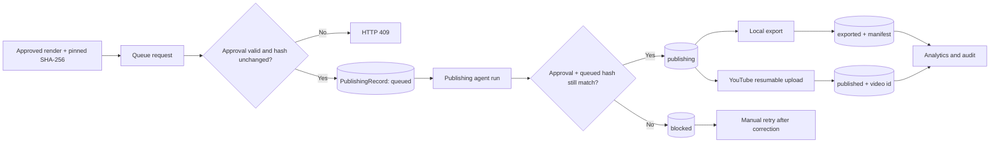

# Phase 10 architecture: Approval-gated publishing



## Separation of concerns

Editorial approval answers “may this exact artifact be published?” Publishing answers “was the delivery attempt successful?” The two states are stored separately:

- `ContentApproval.status`: `pending`, `approved`, `rejected`, `changes_requested`.
- `PublishingRecord.status`: `queued`, `publishing`, `exported`, `published`, `failed`, `blocked`.

A publishing record references its approval and stores the approved artifact hash in `metadata_json.approved_artifact_sha256` at queue time. The publishing agent checks both the current approval hash and that queue-time pin. An artifact change therefore cannot be laundered through a later approval.

## Providers

### Local export (default, no credentials)

`LocalExportPublisher` copies the approved MP4 into:

```text
assets/published/local/<video_render_id>/<title-slug>.mp4
assets/published/local/<video_render_id>/metadata.json
```

The manifest records the title, description, tags, duration, source path, exported path, and approved artifact hash. The result status is `exported`, never `published`, so local delivery is not confused with a public upload.

### YouTube (optional)

`YouTubePublisher` uses the official YouTube Data API v3 resumable upload protocol:

1. Exchange a stored OAuth refresh token at `https://oauth2.googleapis.com/token`.
2. Create a resumable upload session with `part=snippet,status`.
3. Upload the MP4 bytes and store the returned video ID.

Required environment variables:

```dotenv
NEWS_PUBLISHING_YOUTUBE_CLIENT_ID=
NEWS_PUBLISHING_YOUTUBE_CLIENT_SECRET=
NEWS_PUBLISHING_YOUTUBE_REFRESH_TOKEN=
NEWS_PUBLISHING_YOUTUBE_PRIVACY_STATUS=private
NEWS_PUBLISHING_YOUTUBE_CATEGORY_ID=25
NEWS_PUBLISHING_YOUTUBE_DEFAULT_LANGUAGE=en
NEWS_PUBLISHING_YOUTUBE_MADE_FOR_KIDS=false
```

The adapter never asks for or logs the account password. Default privacy is `private`, and the operator must review platform policy before changing it. Publishing to YouTube consumes the project's free API quota; no paid third-party service is required.

## Idempotency and failure handling

- `PublishingRecord` has unique constraints on `(video_render_id, platform)` and `idempotency_key`, so the same approved artifact cannot be queued twice for one platform.
- The queue request re-hashes the MP4 and rejects missing, mismatched, or unapproved artifacts.
- The agent loads only `queued` records, in creation order.
- It records `publishing` and commits before the external side effect. A process crash leaves an explicit in-flight record instead of a silently retryable upload.
- Provider exceptions become `failed` with a truncated error message; hash/approval violations become `blocked`. One record failing does not stop the rest of the batch.
- `POST /api/v1/publishing/records/{record_id}/retry` re-queues only `failed` or `blocked` records. The approval and pinned hash are checked again on the next run.
- Analytics report status/platform counts, approved-video and pending-review counts, external publish count, and a success rate over a configurable day window.

## Operational API

- `POST /api/v1/publishing/queue` - validate approval/hash and create a queued record.
- `POST /api/v1/publishing/runs` - process queued records immediately.
- `GET /api/v1/publishing/records` - filter by status, platform, or render.
- `GET /api/v1/publishing/analytics?days=30` - delivery and review metrics.
- `POST /api/v1/publishing/records/{record_id}/retry` - re-queue a failed or blocked attempt.

The scheduler can also process the queue on `NEWS_PUBLISHING_INTERVAL_MINUTES`, but filling the queue is always an explicit action taken after approval.

## Verification

- `tests/test_publishing.py` covers unapproved queue rejection, duplicate queue rejection, local export and manifest creation, hash tampering (including re-approval after tampering), retry semantics, and a mocked YouTube resumable upload.
- `tests/test_api_integration.py` covers the routed approve → queue → export → analytics path.
- Real YouTube credentials and a real upload were not exercised in this environment; the official endpoint sequence is verified with `respx` HTTP mocks.
