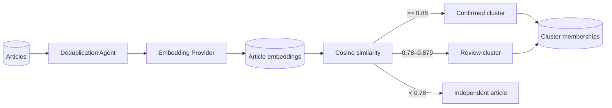

# Phase 2 architecture: Semantic Deduplication Agent

## Design

The default local provider is SentenceTransformers with `all-MiniLM-L6-v2`. It is a compact, well-supported baseline for semantic similarity; the provider protocol makes a multilingual or domain-tuned model a configuration/integration change instead of an agent rewrite. The official SentenceTransformers documentation explicitly supports semantic similarity, clustering, and cosine similarity with this model family.

Embeddings are versioned by model name and stored as JSON arrays in SQLite. This is deliberately simple for the prototype and maintains model provenance. A PostgreSQL/pgvector repository is the intended next storage adapter; it can retain the cluster contract while replacing the SQLite candidate scan.

## Threshold policy

- `>= 0.88`: automatically confirmed duplicate group.
- `0.78–0.879`: retained as a human-review group.
- `< 0.78`: no relationship is created.

These are safe starting values, not universal truth. Calibrate them against a labeled sample of your sources before publishing automation depends on them. The source articles are retained in every case.

## Tests

The tests use a deterministic fake embedding provider, so they never download model weights. Production runs load the configured model locally, batch only unembedded articles, and record execution details in `agent_runs`.
