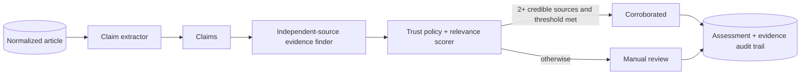

# Phase 3 architecture: Credibility Agent

## Guardrails

The score is an evidence-based **corroboration estimate**, never a declaration that a claim is true. The agent caps scores at `0.65` if fewer than two independent trusted sources are found, so a single publisher cannot automatically pass the configured `0.75` confidence threshold.

`config/trust.yml` is an explicit, version-controlled editorial policy. It is a weighted input to the assessment and must be reviewed by the editorial team; source reputation alone cannot verify a particular claim.

## Local AI option

The default extractor is deterministic and conservative. To improve claim atomization, configure an Ollama model locally. The Ollama chat API supports non-streaming JSON/structured outputs, which keeps claim extraction machine-parseable without sending article text to a paid service.

## Next improvement

The current evidence finder is local-corpus-only and uses lexical relevance to identify candidate corroboration. The next safe extension is a source-policy-filtered public search adapter plus an LLM/NLI comparison stage that labels evidence as support, contradiction, or unrelated. It should remain review-first for contested or breaking news.
