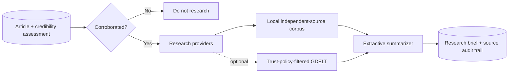

# Phase 4 architecture: Research Agent

## Design and safety

The Research Agent is deliberately downstream of credibility: reports in `needs_review` do not become enriched content that could look authoritative. It stores all research-source links and snippets, produces extractive facts and context, and adds an uncertainty note rather than resolving conflicts on its own.

The default provider is local-corpus-only. The optional GDELT DOC 2.0 adapter is key-free and supplies recent article-list results; its output is filtered through `config/trust.yml` before it can enter a brief. GDELT results remain candidates, not verification evidence.

## API

- `POST /api/v1/research/runs` runs eligible articles.
- `GET /api/v1/articles/{article_id}/research` returns the briefing and its sources.

## Next phase

Use the research brief as input to a neutral Script Writer Agent. Keep the script generator constrained to stored evidence, cite sources internally, and automatically route any uncertainty-heavy brief for review before narration or video production.
