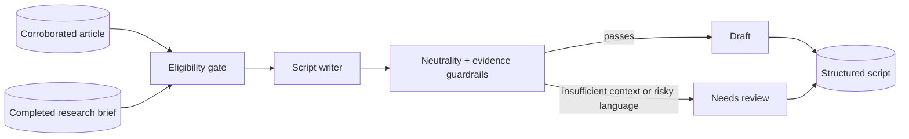

# Phase 5 architecture: Script Writer Agent

## Design

The agent does not accept unassessed articles or research briefs that have not completed. The default writer is extractive, which makes it suitable for a fully local baseline: every substantive line comes from the persisted article or research brief. The optional Ollama writer uses structured JSON output but remains subject to the same eligibility and guardrails.

Extractive drafts are trimmed against `NEWS_SCRIPT_TARGET_SECONDS` before storage, using a conservative 2.0 words/second estimate. Context is removed first, then trailing main-story sentences, while at least one evidence-backed sentence is retained. Scripts estimated above 1.25x the target are still flagged for review.

`draft` and `needs_review` are workflow states, not approval states. Phase 8's dashboard will provide an explicit human approve/reject action before the system is allowed to generate publishing work.

## API

- `POST /api/v1/script-writer/runs` generates eligible narration drafts.
- `GET /api/v1/articles/{article_id}/script` returns the structured script, full text, estimate, and review reasons.

## Next phase

Generate editable scene plans from the approved script structure: visual keywords, stock-footage queries, image queries, animation suggestions, and timing. Keep any visual planning separate from final video rendering.
