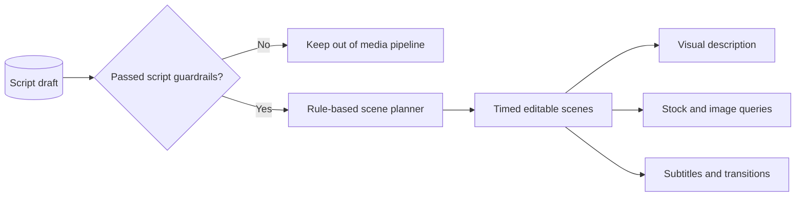

# Phase 6 architecture: Scene Planner Agent

## Design

Scene planning is a separate data layer, not video generation. Each record preserves the exact narration segment, start time, duration, subtitle, and visual guidance, so a future dashboard can edit any scene without rewriting the script. The initial planner is deterministic and asset-agnostic: it suggests queries but does not fetch, generate, or claim rights to assets.

Only `draft` scripts may receive a scene plan. `needs_review` scripts remain excluded from media work, ensuring that automated review signals cannot be bypassed downstream.

## API

- `POST /api/v1/scene-planner/runs` creates scene plans for eligible scripts.
- `GET /api/v1/scripts/{script_id}/scene-plan` returns the ordered editable timeline.

## Next phase

Generate narration audio with an open-source TTS provider. The TTS Agent should chunk the approved script, normalize and merge the output, and preserve segment timing for video synchronization.
