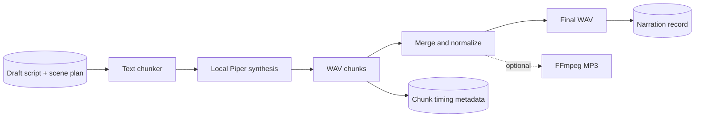

# Phase 7 architecture: TTS Agent

## Design

Piper is used behind a narrow synthesizer interface, so another open-source engine such as Kokoro, XTTS, or MeloTTS can replace it without changing the workflow or data contract. Piper runs locally with text on standard input and a local voice model; the agent never sends scripts to a paid service. The selected Piper implementation expects WAV output and uses the standard Piper `--model` and `--output_file` flow. [Piper usage](https://github.com/WEBDIENSTE/rhasspy-piper)

The agent stores chunk source text, paths, start times, and durations. WAV merging validates that all chunks use the same format, then normalizes a shared peak level. MP3 export is optional, local, and requires an FFmpeg executable.

## API

- `POST /api/v1/tts/runs` creates narration for eligible scripts.
- `GET /api/v1/scripts/{script_id}/narration` returns the final files and ordered chunk timing.

## Verification

- `tests/test_tts.py` covers chunking, merged audio, timing metadata, and the optional MP3 path with a deterministic fake synthesizer.
- A real local smoke run on 2026-10-25 used Piper `2023.11.14-2` with the `en_US-lessac-medium` voice and produced a 14.505-second WAV plus a 58 KB MP3. The `/system/status` capability report returned `piper_tts: true` and `tts_ffmpeg: true`.

## Next phase

Render the planned scenes and narration into editable video timelines. Use FFmpeg for deterministic production rendering; retain the scene plan as the source of truth for subtitles, transitions, and timing.
