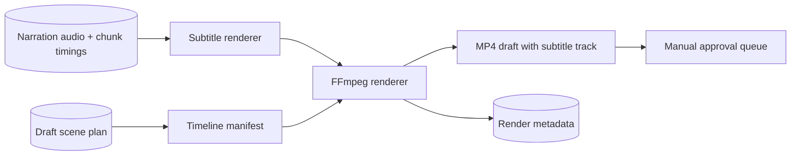

# Phase 8 architecture: Video Generator Agent

## Design

The baseline renderer creates a deterministic, neutral-background MP4, muxes the local narration, and adds a selectable subtitle track derived from actual synthesized timings. It uses FFmpeg's `lavfi` color source for the video layer and an SRT subtitle input rather than depending on a browser, cloud renderer, or copyrighted visual source. [FFmpeg documentation](https://www.ffmpeg.org/ffmpeg.html)

The agent writes a JSON timeline manifest from the editable scene plan, including visual and animation guidance. A future asset resolver can populate licensed visual media without changing subtitle timing or the rendering contract. Until then, no stock media is downloaded automatically.

Each render is deliberately created in `draft` status. The video agent also creates a pending approval record so it appears in the review queue; see [Phase 9](phase-9-review-approval.md) for the quality gate and explicit human approval flow.

## API

- `POST /api/v1/video-generator/runs` renders eligible local drafts.
- `GET /api/v1/narrations/{narration_id}/video` returns the MP4, subtitle, and timeline artifact metadata.
