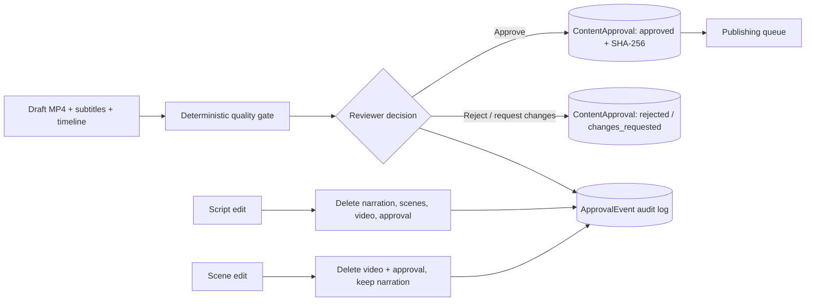

# Phase 9 architecture: Review and approval

## Data model

- `content_approvals` stores one approval per `VideoRender`, including status, reviewer, notes, quality-check results, decision time, and the SHA-256 of the approved artifact.
- `approval_events` is append-only and records approvals, rejections, change requests, script edits, scene edits, and media invalidation. It intentionally uses loose ID columns so events survive regeneration of the media rows.

Approval status is independent of publishing status. A review decision does not create a publishing record, and a publishing record does not imply that a later review decision is still valid.

## Deterministic quality gate

The gate in `backend/app/reviews/quality.py` runs before an approval is accepted:

| Check | Failure condition |
| --- | --- |
| `video_file` | Missing file or smaller than `NEWS_APPROVAL_MIN_VIDEO_BYTES` |
| `subtitles` | Missing SRT or no timed cue marker |
| `timeline` | Missing, invalid, empty, or non-list JSON manifest |
| `duration` | Non-positive duration; unusually long durations produce a warning |
| `resolution` | Non-positive or odd width/height (H.264 requires even dimensions) |
| `script_gate` | Script is missing, still flagged for review, or no longer in `draft` status |

A failed check blocks approval with HTTP 422 and returns the check list. Quality checks are not a substitute for editorial review of accuracy, fairness, or legal risk.

## Review API

- `GET /api/v1/reviews` - ranked queue with filters and analytics.
- `GET /api/v1/reviews/{video_render_id}` - full provenance: article, credibility evidence, research brief, script, scenes, narration, quality checks, approval, and publishing records.
- `POST /api/v1/reviews/{video_render_id}/decision` - `approve`, `reject`, or `request_changes`.
- `GET /api/v1/reviews/videos/{video_render_id}/file` - stream the draft MP4 to the dashboard.
- `PATCH /api/v1/reviews/scripts/{script_id}` - edit narrative fields.
- `PATCH /api/v1/reviews/scenes/{scene_id}` - edit visual/subtitle fields.
- `GET /api/v1/reviews/analytics` - pending, approved, rejected, changes-requested, published, and exported counts.

## Editing and invalidation

Editing generated content must not leave stale media that still appears approved.

- **Script edits** require `acknowledge_media_invalidation=true` when downstream media exists. They delete narration chunks/audio, scene plans/scenes, video renders, and approvals for that script, then rebuild `full_text`, duration, guardrail reasons, and status. Scripts with publishing activity cannot be edited.
- **Scene edits** require the same acknowledgement when a render exists. They delete the video render and its approval but retain narration because timing and text are unchanged. Scenes with publishing activity cannot be edited.
- **Approval locking:** once any publishing record exists, review decisions and content edits are blocked. This prevents an artifact that was queued or published from being re-approved after a modification.
- File deletion is restricted to paths inside the configured output directories.

## Queue ranking

The review queue computes a transparent priority score from credibility confidence, source trust weight, recency, and pending-review bonus. It is a triage aid, not a newsworthiness claim or an approval signal.

## Frontend

`frontend/` is a dependency-free HTML/CSS/vanilla-JS dashboard served by FastAPI at `/dashboard`. It provides the queue, provenance and evidence inspection, video preview, quality-check display, script/scene editors, approval controls, publishing queue, run logs, and article library. All dynamic text is escaped before insertion into HTML, and source links are restricted to HTTP(S).

## Verification

- `tests/test_review_workflow.py` covers the quality gate, artifact hashing, approval audit events, script invalidation, scene invalidation with retained audio, review listing, and review detail.
- `tests/test_api_integration.py` exercises the routed approval, lock, and local publishing flow over ASGI HTTP.
- `tests/test_dashboard.py` verifies dashboard asset serving and unknown-asset rejection.
